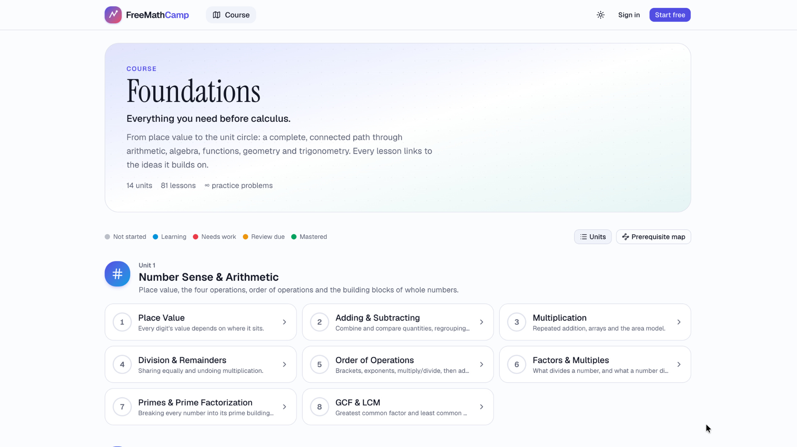

# FreeMathCamp



FreeMathCamp is a free online maths course for everything a learner needs before calculus. The first course, **Foundations**, is a connected path of 81 lessons across 14 units, from place value to the unit circle.

Each lesson explains an idea, shows it, and then practises it. Problems are generated for the person in front of the screen. Difficulty moves with them, reviews return before an idea fades, and nothing is locked behind a prerequisite.

It is live at [freemathcamp.app](https://freemathcamp.app). There is no paywall and no advertising. An account saves progress and builds a personal plan.

## Who it is for

Foundations starts from the basics and does not assume earlier study. It suits:

- students getting ready for calculus
- adults returning to maths
- anyone filling gaps before algebra, physics, data science or programming

You can open any lesson. Earlier lessons are listed as background, and the course will suggest them when they would help.

## The Foundations course

Fourteen units, taught in order and linked by the ideas they share.

| | Unit | Lessons |
| --- | --- | --- |
| 1 | Number Sense & Arithmetic | 8 |
| 2 | Integers & Negative Numbers | 4 |
| 3 | Fractions | 7 |
| 4 | Decimals & Percentages | 5 |
| 5 | Ratios & Proportions | 3 |
| 6 | Exponents & Roots | 7 |
| 7 | Algebra Foundations | 9 |
| 8 | Graphs & Linear Equations | 5 |
| 9 | Functions | 6 |
| 10 | Polynomials & Quadratics | 8 |
| 11 | Exponentials & Logarithms | 4 |
| 12 | Geometry | 7 |
| 13 | Trigonometry | 5 |
| 14 | Sequences & Series | 3 |

The course map shows where each lesson sits: not started, learning, needs work, review due, or mastered. A prerequisite map draws the whole graph, so a topic’s dependencies are visible at a glance.

## How learning works

A session is short and specific. Learn mode is six problems, a review is five, and a challenge set is eight. There are three difficulty levels.

**The level moves during the session.** Two clean solves in a row step the difficulty up. A heavy struggle steps it back. Challenge sets always begin gently.

**Struggle is measured, not guessed.** A wrong answer weighs most, then time against a baseline for that problem, then hints. Revealing the solution counts as a full struggle. These combine so no single factor can dominate the score.

**Mastery is a probability.** Bayesian knowledge tracing updates the chance that the idea has been learned, with a forgetting curve whose stability is the current review interval. Well-spaced topics fade slowly. Harder problems count as stronger evidence.

**Reviews follow a spaced schedule** in the style of SM-2. A solid session stretches the interval. A poor one brings the topic back the next day. Intervals are capped at 180 days.

After each session the home page rebuilds four queues, then interleaves them into a plan for the day:

- **Review** — topics that are due.
- **Strengthen** — topics with a high struggle score, plus weak prerequisites worth a short brush-up.
- **New** — lessons not yet started, ranked by how ready the prerequisites are and how much later material they unlock.
- **Keep going** — lessons already in progress.

A streak and a daily goal (ten problems by default, adjustable in settings) sit alongside the plan.

## What a lesson contains

Lessons are read on the page. They are not videos.

- Explanations with typeset mathematics (KaTeX), named rules, callouts and step-through worked examples.
- Animated diagrams and interactive explorers for slope, lines, parabolas, transformations, the unit circle, systems of equations, Pythagoras and more.
- Unlimited practice. Each problem is produced from a seed. The API regenerates that same problem to mark the answer, so a score cannot be submitted from the browser.
- Hints, and the option to reveal a solution when you are stuck.

## Progress, account and settings

The progress page fills in once practice begins: an activity heatmap, first-try accuracy, time spent, hints and reveals, mastery by unit, a difficulty breakdown, and a view of strengths and weak spots.

Accounts support email and password, with email verification, and optional Google sign-in. Settings cover profile, daily goal, light, dark and system appearance, notifications, password, active sessions, a data export, resetting progress, and deleting the account.

A notification centre (behind the avatar) collects account notices, milestones and practice reminders. Notifications can be kept or dismissed. The API delivers them itself, by Web Push, APNs for the coming iOS app, and email for security notices and re-engagement reminders, with no Firebase. See [docs/notifications.md](docs/notifications.md).

## Stack

| Area | Choice |
| --- | --- |
| Monorepo | pnpm workspaces, TypeScript throughout |
| Curriculum | `packages/curriculum` — lessons, seeded generators, answer checking and the prerequisite graph, shared by the API and the web app |
| API | Node, Express 5, Effect 3, Kysely, Postgres 17, Argon2id, Vitest |
| Web | Next.js 16 (App Router, Cache Components), React 19, Tailwind 4, shadcn/ui (Base UI), TanStack Query, Motion, KaTeX, Mafs, Recharts, React Flow |

```
apps/
  api/                 Express + Effect API
    src/domain/          learning engine (pure) and errors
    src/application/     use cases and repository ports
    src/infrastructure/  Postgres, migrations, security, email, Google OAuth
    src/http/            Express adapters, validation, middleware
  web/                 Next.js app
packages/
  curriculum/          Foundations content and generators
```

The engine itself has no I/O. Signals, mastery, scheduling, difficulty and recommendations are pure functions, covered by unit tests. Curriculum generators are fuzz-tested. API tests run against Postgres.

## Getting started

You need Node 22 or newer, pnpm 10, and Docker.

```bash
pnpm install
pnpm setup   # writes .env files with generated secrets, starts Postgres, runs migrations
pnpm dev     # API on :4100, web on :3000
```

Open http://localhost:3000. The web app proxies `/api/*` to the API, so cookies stay first-party.

`pnpm setup` leaves existing env files alone. Keep a copy of `.env` and `.env.production` before you replace them.

### Google sign-in

Optional. In Google Cloud Console, create an OAuth client of type *Web application* with this redirect URI:

```
${WEB_ORIGIN}/api/auth/google/callback
```

In production that is `https://freemathcamp.app/api/auth/google/callback`. Set `GOOGLE_CLIENT_ID` and `GOOGLE_CLIENT_SECRET`. The “Continue with Google” button appears once both are set.

## Docker

**Development.** `pnpm db:up` starts Postgres on its own. `pnpm dev:docker` also runs the API in a hot-reloading container.

**Production.** `pnpm docker:prod` starts Postgres on a private network, runs migrations as a one-shot job, then starts a read-only, non-root API container. Put a TLS-terminating proxy, or the Next.js app, in front of it.

## Deployment

Pushes to `main` deploy the two halves separately.

**Web, on Vercel.** The Vercel project `freemathcamp` uses `apps/web` as its root and serves [freemathcamp.app](https://freemathcamp.app). `www` redirects to the apex. `deploy/vercel-ignore.sh` skips a build unless `apps/web`, `packages/curriculum` or the lockfile changed.

Set `API_URL=https://api.freemathcamp.app` and `PROXY_SECRET`.

**API and Postgres, on the VPS.** `.github/workflows/deploy-api.yml` runs when a push touches `apps/api`, `packages/curriculum`, the lockfile, `docker-compose.prod.yml` or `deploy/vps.sh`.

1. Typecheck, migrate and run the tests against a Postgres service container.
2. SSH to the VPS (secret `VPS_SSH_KEY`, host key pinned), update `/var/www/freemathcamp` to `origin/main`, and run `deploy/vps.sh`.
3. The script builds the image, starts Postgres, runs migrations, and swaps the API container once it is healthy. The API listens on `127.0.0.1:4003`. Postgres is not published.

Nginx terminates TLS for `api.freemathcamp.app` (certbot) and proxies to the API. See `deploy/nginx/api.freemathcamp.app`. Server secrets live in `/var/www/freemathcamp/.env`, taken from `.env.production`.

The browser only talks to `freemathcamp.app`. Next.js forwards `/api/*` to the API, signed with `PROXY_SECRET` and carrying the visitor’s IP. The API trusts that IP when the signature matches, so rate limits apply per learner. `PROXY_SECRET` must be the same on Vercel and the VPS.

DNS for `freemathcamp.app` is on Cloudflare, with every record set to DNS-only: `api` points at the VPS, and the apex and `www` point at Vercel.

## Scripts

Run these from the repository root.

| Command | What it does |
| --- | --- |
| `pnpm setup` | First run: create any missing env files, start Postgres, migrate |
| `pnpm dev` | API and web in watch mode |
| `pnpm dev:full` | Start Postgres, migrate, then run `pnpm dev` |
| `pnpm dev:api` / `pnpm dev:web` | Run one side only |
| `pnpm build` | Production builds of the API and the web app |
| `pnpm start` | Run the production builds (`start:api` / `start:web` for one side) |
| `pnpm check` | Typecheck, lint and test |
| `pnpm test` | Curriculum fuzz tests, engine unit tests, API integration tests (needs the database) |
| `pnpm test:engine` / `pnpm test:curriculum` | Fast subsets that do not need a database |
| `pnpm db:up` / `pnpm db:down` | Start (and wait for) or stop the dev Postgres |
| `pnpm db:migrate` / `pnpm db:rollback` | Apply or revert migrations |
| `pnpm db:psql` | Open a psql shell on the dev database |
| `pnpm db:reset` | Delete the dev database volume, recreate it and migrate |
| `pnpm dev:docker` / `pnpm dev:docker:down` | Postgres plus a hot-reloading API in Docker. Ctrl+C stops the stack; `down` removes the containers and keeps the data |
| `pnpm docker:prod` | Build and start the production stack, using `.env.production` |
| `pnpm docker:prod:logs` / `pnpm docker:prod:down` | Follow API logs, or stop the production stack |
| `pnpm clean` | Remove build output |

## Security

- Passwords are hashed with Argon2id at OWASP parameters. Login compares in constant time.
- Session tokens are 256-bit random values. Only the SHA-256 is stored. Cookies are `HttpOnly` and `SameSite=Lax`, and use the `__Host-` prefix with `Secure` in production. Expiry slides forward with use.
- State-changing requests must come from the web origin and carry JSON.
- Rate limits apply globally, with stricter per-IP and per-email limits on authentication. Responses use Helmet headers, schema-validated input, and no-store caching.
- Google OAuth uses state and PKCE, requires a verified email, and does not silently link to an existing password account.
